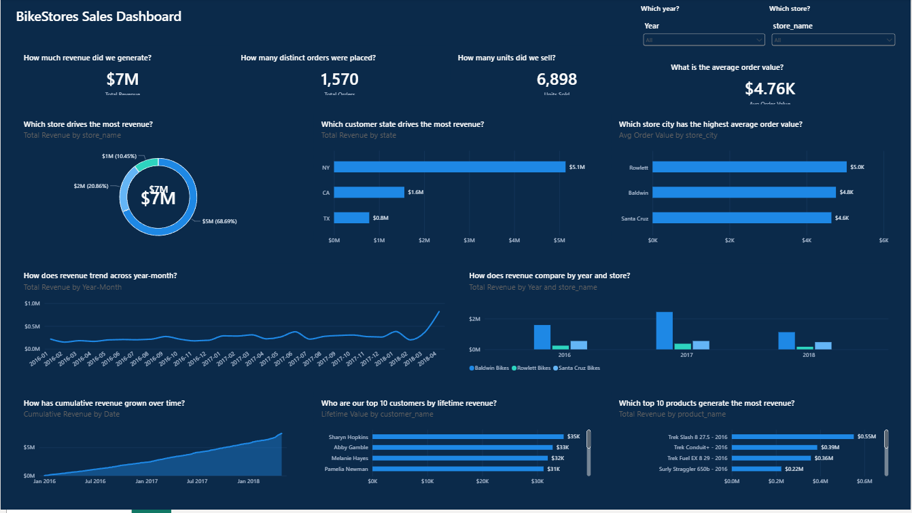
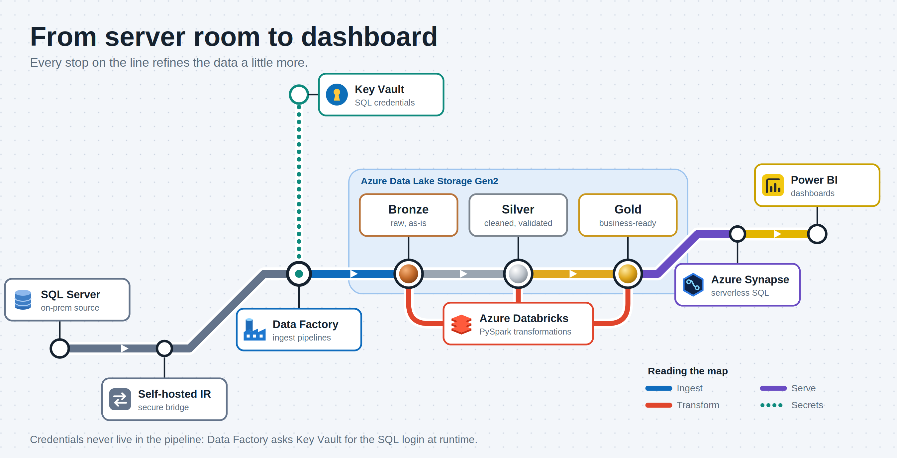
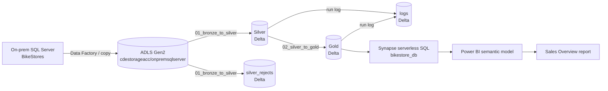

# BikeStores Sales Dashboard

An end-to-end analytics project that takes the BikeStores operational database from an on-premises SQL Server, lands it in Azure Data Lake Storage Gen2, refines it through a Bronze -> Silver -> Gold medallion pipeline in Databricks, publishes the Gold layer through Azure Synapse serverless SQL, and presents it in a custom-themed Power BI report.



---

## Table of contents

- [Overview](#overview)
- [Reference architecture](#reference-architecture)
- [Solution architecture](#solution-architecture)
- [Repository structure](#repository-structure)
- [Data pipeline](#data-pipeline)
  - [Bronze -> Silver](#bronze---silver)
  - [Silver -> Gold](#silver---gold)
- [Data model](#data-model)
- [Dashboard](#dashboard)
- [Azure resources used](#azure-resources-used)
- [Getting started](#getting-started)
  - [Open the report](#open-the-report)
  - [Run the notebooks](#run-the-notebooks)
  - [Refresh the model](#refresh-the-model)
- [Design decisions](#design-decisions)
- [Known limitations](#known-limitations)
- [Reference](#reference)

---

## Overview

The project follows a layered medallion architecture:

| Layer | Storage | Format | Purpose |
|-------|---------|--------|---------|
| Bronze | ADLS Gen2 `onpremsqlserver` container | CSV | Raw copies of the BikeStores source tables |
| Silver | ADLS Gen2 `silver/` | Delta | Cleaned, typed, deduplicated, quality-checked tables |
| Gold | ADLS Gen2 `gold/` | Delta | Business-ready facts and aggregates |
| Serving | Azure Synapse serverless SQL `bikestore_db` | External tables | Query layer for Power BI |
| Presentation | Power BI semantic model + report | Import mode | KPIs, trends, rankings, slicers |

Key outcomes:

- Standardised types and null handling across 9 source tables.
- Rule-based data quality with **rejected rows quarantined** (not silently dropped).
- Per-run audit logs for both pipeline stages.
- A star-schema-style Gold layer with fact sales, daily/monthly summaries, product ranking, customer lifetime value and store performance.
- A single-page, dark-themed Power BI report driven by reusable DAX measures and a dedicated Calendar table.

---

## Reference architecture

The solution follows the reference architecture from the assignment brief: an on-premises SQL Server reached through a Self-hosted Integration Runtime, ingested by Azure Data Factory (with SQL credentials pulled from Azure Key Vault at runtime), refined through Bronze, Silver and Gold in ADLS Gen2 by Azure Databricks, served by Azure Synapse serverless SQL and visualized in Power BI.



---

## Solution architecture



The notebooks read and write exclusively through the Unity Catalog external location (`abfss://...`), so no storage credentials are embedded in code.

---

## Repository structure

```text
bikestore-dashboard/
├── 01_bronze_to_silver.ipynb          # Cleaning, dedupe, DQ rules, quarantine
├── 02_silver_to_gold.ipynb            # Gold facts, aggregates, rankings
├── dashboard.pbip                     # Power BI project entry point
├── dashboard.Report/                  # PBIR report definition
│   ├── definition/
│   │   ├── report.json                # Theme and report settings
│   │   └── pages/…                    # Page and visual definitions
│   └── StaticResources/               # BikeStoresDark custom theme
├── dashboard.SemanticModel/           # TMDL semantic model
│   └── definition/
│       ├── model.tmdl
│       ├── relationships.tmdl
│       └── tables/…                   # Gold tables + Calendar + measures
├── Screenshot.png                     # Dashboard preview
├── Reference-Architecture.png         # Reference architecture from the brief
├── Assignment From Server Room to Dashboard.pdf
└── .gitignore                         # Excludes local Power BI cache/settings
```

---

## Data pipeline

### Bronze -> Silver

`01_bronze_to_silver.ipynb` processes each source table with a declarative spec (`SPEC`) that defines business keys, target types, default values and data quality rules.

Processing steps per table:

1. Read the raw CSV from the Bronze path as strings (`header=true`, `NULL` treated as null).
2. Cast columns to the agreed data types.
3. Trim strings and convert blank values to null.
4. Apply agreed defaults (for example, `phone = "Unknown"` for customers).
5. Remove duplicates on the business key.
6. Evaluate data quality rules; rows failing any rule are written to `silver_rejects` with `_reject_reason` and `_rejected_at`.
7. Write good rows to `silver/<schema>/<table>` as Delta.
8. Append a run-log entry to `logs/silver_run_log`.

**Source tables and rules**

| Table | Business key | Key rules |
|-------|--------------|-----------|
| `sales.customers` | `customer_id` | customer id not null; valid email pattern |
| `sales.stores` | `store_id` | store id not null |
| `sales.staffs` | `staff_id` | staff id not null |
| `sales.orders` | `order_id` | order date between 2000-01-01 and today; status in 1–4; shipped date not before order date |
| `sales.order_items` | `order_id`, `item_id` | quantity > 0; list price >= 0; discount between 0 and 1 |
| `production.products` | `product_id` | product name not null; price >= 0; model year >= 1990 |
| `production.categories` | `category_id` | category id not null |
| `production.brands` | `brand_id` | brand id not null |
| `production.stocks` | `store_id`, `product_id` | quantity >= 0 |

**Observed Silver run** (from the committed notebook output):

| Table | Read | Duplicates | Rejected | Written |
|-------|------|------------|----------|---------|
| `sales.customers` | 1,445 | 0 | 0 | 1,445 |
| `sales.stores` | 3 | 0 | 0 | 3 |
| `sales.staffs` | 10 | 0 | 0 | 10 |
| `sales.orders` | 1,615 | 0 | 0 | 1,615 |
| `sales.order_items` | 4,722 | 0 | 0 | 4,722 |
| `production.products` | 321 | 0 | 0 | 321 |
| `production.categories` | 7 | 0 | 0 | 7 |
| `production.brands` | 9 | 0 | 0 | 9 |
| `production.stocks` | 939 | 0 | 0 | 939 |

### Silver -> Gold

`02_silver_to_gold.ipynb` builds the business layer from Silver:

- **`fact_sales`** — line-level sales enriched with product, brand, category and store attributes. Order status `3` (Rejected) is excluded from revenue. Order lines that fail inner joins on order/product/brand/category/store are counted as rejected.
  Revenue = `quantity * list_price * (1 - discount)`.
- **`daily_sales_summary`** — revenue, distinct orders and units per order date (710 rows).
- **`monthly_sales_summary`** — revenue, orders and units per month plus `year` and `month` columns (28 rows).
- **`top_products`** — product-level revenue and units with a dense revenue rank (305 products).
- **`customer_lifetime_value`** — lifetime revenue, order count, first/last order date and average order value per customer (1,445 customers).
- **`sales_by_store`** — revenue, orders and units per store with city/state (3 stores).

Observed Gold run: `fact_sales` read 4,722 lines, rejected 123, wrote 4,599. Each Gold table writes a run-log entry to `logs/gold_run_log`.

---

## Data model

The Power BI semantic model imports the Gold tables from **Azure Synapse serverless SQL** (`olympic-data-ondemand.sql.azuresynapse.net`, database `bikestore_db`).

**Tables:** `fact_sales`, `daily_sales_summary`, `monthly_sales_summary`, `top_products`, `customer_lifetime_value`, `sales_by_store`, and a calculated `Calendar`.

**Measures**

| Measure | Table | Definition |
|---------|-------|------------|
| `Total Revenue` | `fact_sales` | `SUM(fact_sales[revenue])` |
| `Total Orders` | `fact_sales` | `DISTINCTCOUNT(fact_sales[order_id])` |
| `Units Sold` | `fact_sales` | `SUM(fact_sales[quantity])` |
| `Avg Order Value` | `fact_sales` | `DIVIDE([Total Revenue], [Total Orders])` |
| `Cumulative Revenue` | `fact_sales` | Running total over the active `Calendar` relationship |
| `Lifetime Value` | `customer_lifetime_value` | `SUM(customer_lifetime_value[lifetime_value])` |

**Calculated columns:** `customer_lifetime_value[customer_name]` concatenates first and last name. The `Calendar` table is generated from the fact date range with Year, Month Number, Month Name (sorted by Month Number) and Year-Month.

**Relationships**

- `fact_sales` -> `Calendar` on `order_date = Calendar[Date]` (active).
- `fact_sales` -> `customer_lifetime_value`, `sales_by_store`, `top_products` on their business keys.
- Date-part-only relationships from `daily_sales_summary`, `monthly_sales_summary` and customer first/last order dates to their auto date tables.
- Auto date/time is enabled, with `fact_sales.order_date` -> local date table marked inactive because `Calendar` is the reporting date dimension.

---

## Dashboard

The report (`dashboard.Report`) is a single 1920 x 1080 page named **Sales Overview**, using the base theme `Fluent2-CY26SU10` plus the custom `BikeStoresDark` theme.

**KPI cards**

- Total Revenue — `$7M`
- Total Orders — `1,570`
- Units Sold — `6,898`
- Avg Order Value — `$4.76K`

**Visuals**

| Question | Visual |
|----------|--------|
| Which store drives the most revenue? | Donut, Total Revenue by `store_name` |
| Which customer state drives the most revenue? | Horizontal bar, Total Revenue by state |
| Which store city has the highest average order value? | Bar, AOV by `store_city` |
| How does revenue trend across year-month? | Line, Total Revenue by Year-Month |
| How does revenue compare by year and store? | Stacked column, Total Revenue by Year and `store_name` |
| How has cumulative revenue grown over time? | Area, Cumulative Revenue by Date |
| Who are our top 10 customers by lifetime revenue? | Ranked bar, Lifetime Value by `customer_name` |
| Which top 10 products generate the most revenue? | Ranked bar, Total Revenue by `product_name` |

**Slicers:** `Year` and `store_name`.

---

## Azure resources used

The following resource names are referenced in the notebooks and semantic model:

| Resource | Value |
|----------|-------|
| Storage account | `cdestorageacc` |
| Container | `onpremsqlserver` |
| ABFSS base path | `abfss://onpremsqlserver@cdestorageacc.dfs.core.windows.net` |
| Bronze | container root / `Bronze/<schema>/<table>` |
| Silver | `silver/<schema>/<table>` |
| Rejects | `silver_rejects/<schema>/<table>` |
| Gold | `gold/<table>` |
| Logs | `logs/silver_run_log`, `logs/gold_run_log` |
| Synapse serverless endpoint | `olympic-data-ondemand.sql.azuresynapse.net` |
| Serving database | `bikestore_db` (schema `dbo`) |

No secrets, connection strings or credentials are stored in this repository. Databricks reaches storage through a Unity Catalog external location; Power BI authenticates to Synapse with the signed-in user's credentials.

---

## Getting started

### Open the report

**Prerequisites**

- Power BI Desktop (a version that supports PBIP/PBIR project files and TMDL models).
- Access to the Synapse serverless database and the Gold tables.
- Read access to the ADLS Gen2 container if you plan to re-run the notebooks.

**Steps**

1. Open `dashboard.pbip` in Power BI Desktop.
2. If prompted, sign in to Azure and grant access to `olympic-data-ondemand.sql.azuresynapse.net`.
3. Go to **Home -> Refresh** to load the Gold tables.
4. Use the **Year** and **store_name** slicers to explore the report.

> The report uses **Import** mode partitions pointing at Synapse. To point the model at a different workspace, update the `Sql.Database(...)` source in each table partition (Power Query).

### Run the notebooks

1. Import `01_bronze_to_silver.ipynb` and `02_silver_to_gold.ipynb` into your Databricks workspace.
2. Confirm the cluster can access the Unity Catalog external location for `cdestorageacc`.
3. If your environment differs, update `STORAGE`, `CONTAINER`, `BASE`, `SILVER`, `GOLD`, `REJECTS` and `LOGS` at the top of each notebook, plus the Bronze folder pattern in `process()`.
4. Run `01_bronze_to_silver` first, then `02_silver_to_gold`.
5. Check the run-log DataFrames (`logs/silver_run_log`, `logs/gold_run_log`) for row counts and rejects.
6. Refresh the Power BI model.

### Refresh the model

The model has no incremental refresh policy and no Power Query parameters. A refresh reloads all Gold tables in full. Schedule the refresh after the Gold notebook completes so the report always reads consistent data.

---

## Design decisions

- **Quarantine instead of drop** — rejected rows are preserved in `silver_rejects` with a rule-level reason, so data issues can be investigated without re-running extraction.
- **Declarative quality spec** — all cleaning, typing and rules live in one `SPEC` dictionary per notebook, making new tables and rules easy to add.
- **Delta for curated layers** — Silver and Gold use Delta Lake for schema enforcement, time travel and efficient overwrite; Bronze remains CSV to mirror the source system.
- **Separate serving layer** — Gold is exposed through Synapse serverless SQL so Power BI does not need direct ADLS access.
- **Star-schema-friendly model** — a dedicated `Calendar` table is the active date dimension, with aggregate tables related by business keys.
- **Theme consistency** — a registered `BikeStoresDark` theme drives the dark palette across every visual.

---

## Known limitations

- **Full overwrite only**: the Gold job overwrites each table (`mode("overwrite")`); there is no merge/incremental logic.
- **Hard-coded resource names**: storage account, container and Synapse endpoint are literals in the notebooks and TMDL partitions.
- **Bronze path depends on the extraction layout**: the notebook comment expects `<schema>/<table>/<table>.csv` at the container root, while `process()` reads `Bronze/<schema>/<table>`; keep the Data Factory sink and the notebook path aligned.
- **Auto date/time tables**: the model relies on Power BI auto date tables in addition to `Calendar`; disable auto date/time if you want a smaller model.
- **Ranking window**: `top_products` uses `Window.orderBy` without a partition, which moves data into a single partition (noted by a Spark warning in the notebook output).
- **Deprecated call**: notebooks use `datetime.utcnow()`; migrate to timezone-aware `datetime.now(datetime.UTC)`.
- **Local artifacts ignored**: `.pbi/localSettings.json` and `.pbi/cache.abf` are excluded from version control.

---

## Reference

- Assignment brief: `Assignment From Server Room to Dashboard.pdf`
- Bronze -> Silver notebook: `01_bronze_to_silver.ipynb`
- Silver -> Gold notebook: `02_silver_to_gold.ipynb`
- Power BI project: `dashboard.pbip`
- Dashboard preview: `Screenshot.png`
- Reference architecture: `Reference-Architecture.png`
